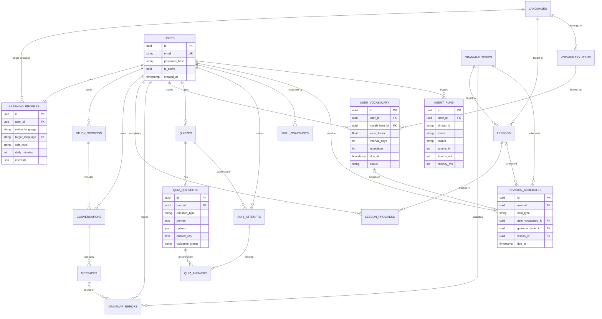

# Database ER Diagram

> **Planned schema.** No tables exist yet. They are created in Phase 2 with Alembic migrations.
> GitHub renders the diagram below automatically.

## Design notes

- 19 tables. "Learning progress" is split into `lesson_progress` and `skill_snapshots`
  so each table has a single meaning.
- `vocabulary_items` holds shared word facts. `user_vocabulary` holds each learner's
  spaced-repetition state (ease factor, interval, due date).
- `revision_schedules` has three optional foreign keys. A CHECK constraint will require
  exactly one of them to be set, which avoids an un-normalised "polymorphic" column.
- `grammar_topics` links mistakes to lessons, so "recommend a relevant grammar lesson"
  becomes a deterministic lookup.
- `agent_runs` is the audit and evaluation trail: intent, tokens, latency, status.
- LangGraph's Postgres checkpointer creates its own tables separately.